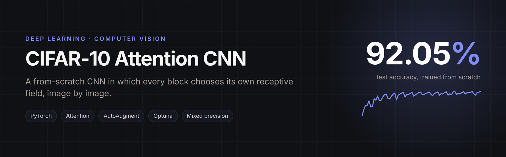
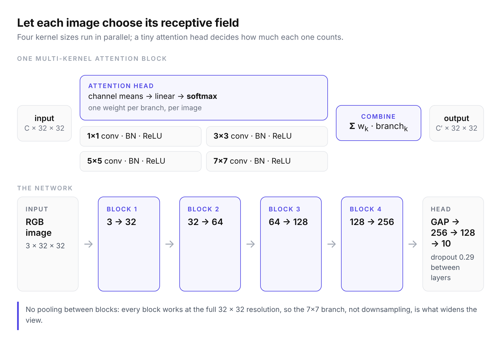
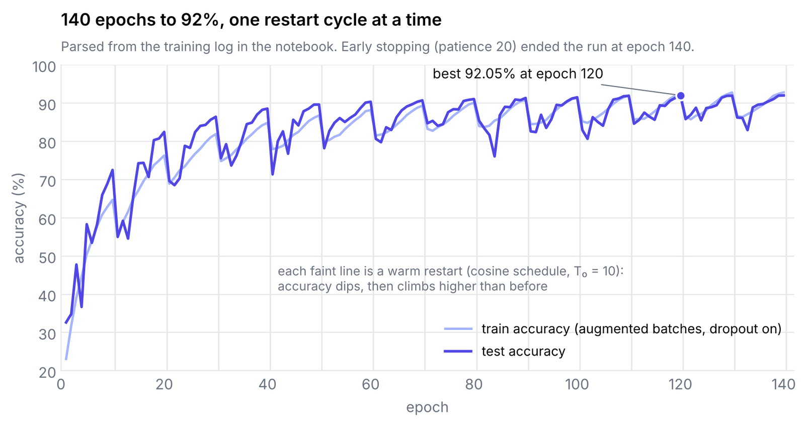

<p align="center"></p>

# CIFAR-10 Image Classification with a Multi-Kernel Attention CNN

A custom convolutional network trained from scratch on CIFAR-10, reaching **92.05% test accuracy**.

**Notebook:** [`cifar10_attention_cnn.ipynb`](cifar10_attention_cnn.ipynb)

## Architecture

The network stacks two kinds of blocks:

- **Intermediate blocks** run 1×1, 3×3, 5×5 and 7×7 convolutions (each with BatchNorm and ReLU) in
  parallel on the same input. A small attention head looks at the channel means of the input and
  produces a softmax weight per branch, so the block learns, image by image, which receptive field to
  trust. The branch outputs are combined as that weighted sum.
- An **output block**: global average pooling, then a 256 → 128 → 10 classifier with dropout.

Four intermediate blocks (3 → 32 → 64 → 128 → 256 channels) feed the output block.

<p align="center"></p>

## Training

| Component | Choice |
|---|---|
| Augmentation | random crop (padding 4), horizontal flip, AutoAugment (CIFAR-10 policy) |
| Loss | label-smoothing cross-entropy (ε = 0.1) |
| Optimiser | SGD with momentum and weight decay, tuned with Optuna |
| Schedule | cosine annealing with warm restarts (T₀ = 10) |
| Precision | mixed precision (`torch.cuda.amp`) |
| Stopping | up to 200 epochs, early stopping with patience 20 |

Tuned hyperparameters: learning rate 0.0277, momentum 0.961, weight decay 6.2e-5, dropout 0.289.

## Result

| Metric | Value |
|---|---|
| Test accuracy (CIFAR-10, 10,000 images) | **92.05%** |

<p align="center"></p>

Test accuracy runs above train accuracy for most of the run. That is expected here: the
training numbers are measured on AutoAugmented batches with dropout active,
while the test set is clean.

**Caveat:** the best checkpoint is chosen on test accuracy, so 92.05% is slightly optimistic. A
held-out validation split from the training set would give an unbiased estimate.

## Run it

```bash
pip install -r requirements.txt
jupyter notebook cifar10_attention_cnn.ipynb
```

CIFAR-10 is downloaded automatically by `torchvision`. A CUDA GPU is strongly recommended.
